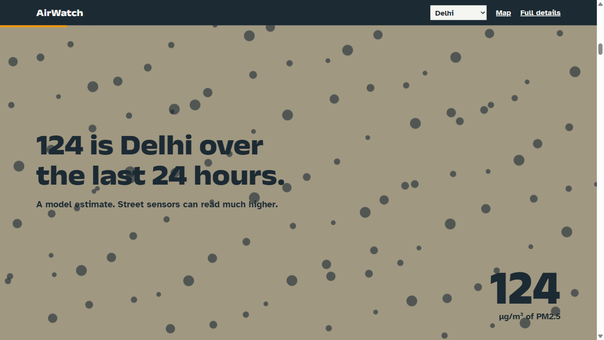
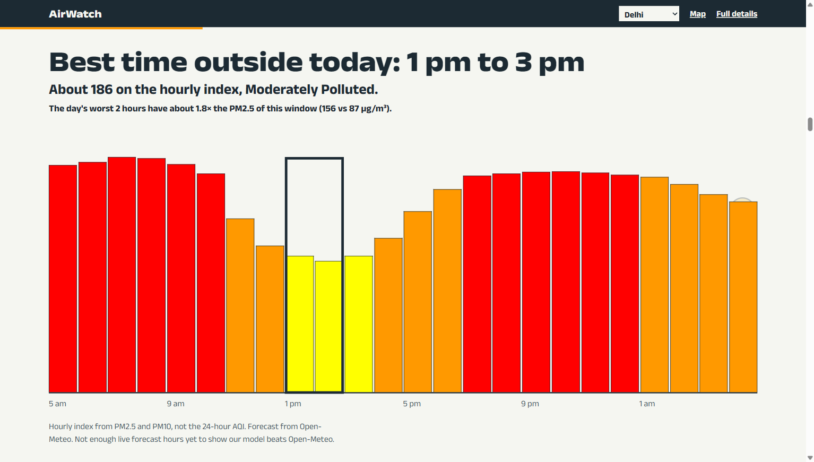
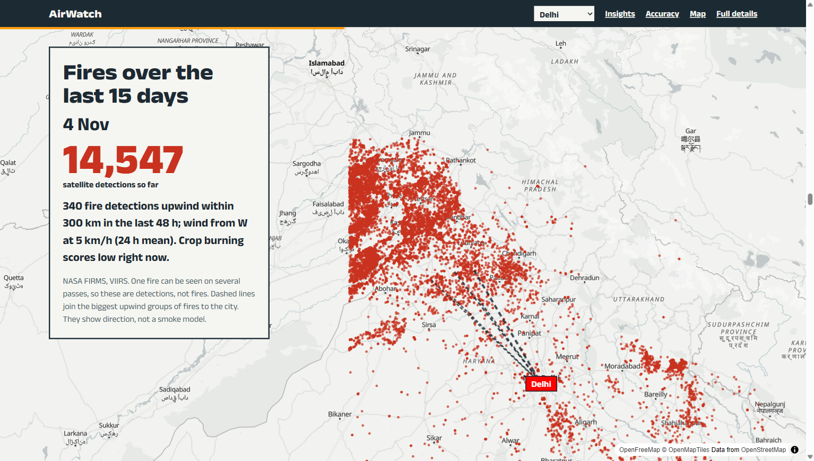
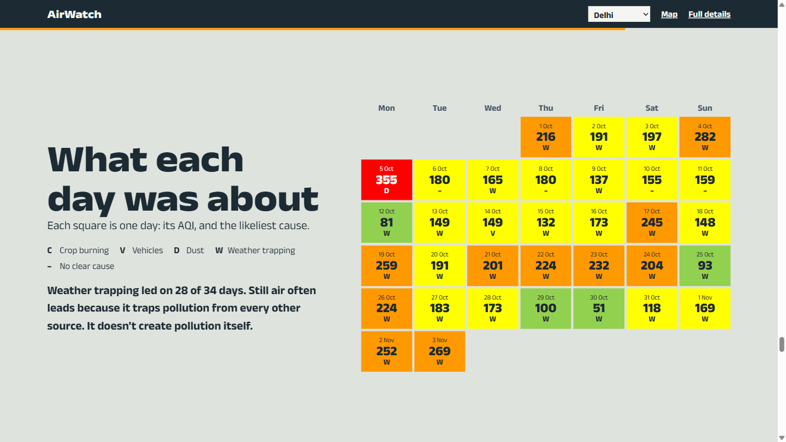
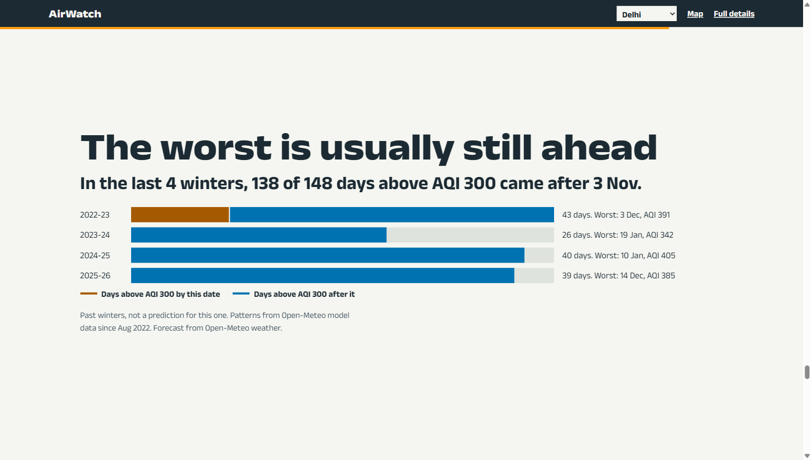
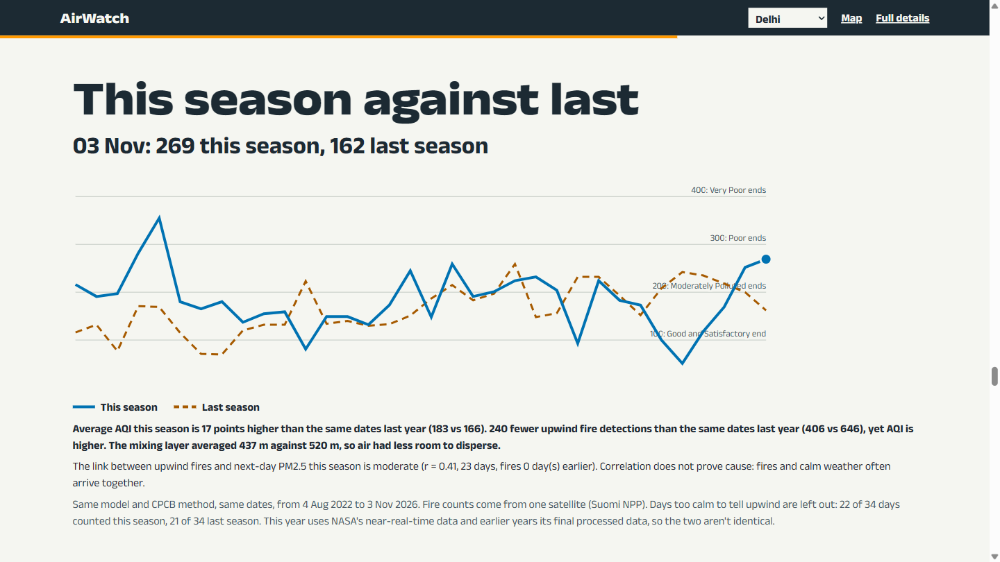

# AirWatch

**Neural Storm 2026, Green Planet track. Problem statement GP-01: Air Quality Monitoring & Source Attribution.**

**Team:** _[team name]_. **Members:** _[member names]_

**Live app:** _[Vercel URL]_ **API:** _[Render URL]_

AirWatch tells people in North India what the air is like in their city, what it will do in the next 24 hours, when the cleanest time to go out is, what is most likely causing it, and how today compares with the past.

| Air fills to the real PM2.5 level | Best time outside |
| --- | --- |
|  |  |
| **Fires appear day by day** | **What each day was about** |
|  |  |
| **What past winters did next** | **This season against last** |
|  |  |

## Problem

Every winter, cities across North India sit under some of the world's worst air. Most apps show a number. They don't say why it's happening, when the air will be better today, or whether this year is really worse than last year. Crop burning, traffic, dust and still weather all get blamed, usually without evidence for that day.

## Solution

For Delhi, Gurugram, Noida, Ghaziabad, Chandigarh, Ludhiana, Lucknow and Kanpur:

- **Now:** AQI by CPCB's method, with its category and the pollutant driving it.
- **Next 24 hours:** an hourly forecast and the best 2-hour window to go outside.
- **Why:** a score and a plain-words reason for crop burning, vehicles, dust and weather trapping.
- **Compared with before:** today against last year and recent weeks, and this season against last, on the same dates.
- **What to do:** general public guidance for the current category.

AirWatch is a scroll-driven site, and every animation is drawn from live data:

| Chapter | What scrolling does |
| --- | --- |
| Specks | Fills the sky at 1 speck per µg/m³: the WHO guideline, India's standard, then the city's real level, ending on its AQI |
| Four things to know | Shows the main insights right after the AQI |
| Today | Raises a skyline of the next 24 hours, then brackets the best window |
| Fires | Moves the map towards the fires as real detections appear day by day |
| Why | Fills each likely cause to its score, with its reason |
| This season against last | Draws both seasons on the same dates |
| Day by day | Lands each day of the season with its AQI and likely cause |
| What happens next | Shows what has cleared the air before, whether that's in the forecast, and how past winters unfolded from this date |
| How our numbers tested | Shows forecast test errors, then how the model compares with real CPCB stations |
| What to do | Gives guidance for the current category |

Insights are worked out per city from its own record, and a city only gets a claim its data supports:

- **The worst is usually still ahead:** how past winters split around today's date.
- **What would clear the air:** PM2.5 on still days against windy days, and the day after rain, paired with the forecast.
- **What timing saves:** the best window against the day's worst 2 hours.
- **Days over the limit:** days over India's standard and the WHO guideline, against the same dates in earlier years.

Compared with typical AQI dashboards, which stop at the number, AirWatch explains the cause and the best time to go out, and says how sure it is. A map with a date slider (`#/map`) and a full details page (`#/city/delhi`) are also included.

## Tech stack

- **Backend and all AI/ML (Python):** FastAPI, httpx, pandas, pyarrow, LightGBM, pydantic, pytest
- **Frontend:** React, Vite, TypeScript, a small hand-written scroll engine, canvas, SVG, MapLibre GL with OpenFreeMap tiles, Recharts, installable PWA
- **Caching:** in-memory TTL plus parquet on disk, with the last good copy served and labelled if an upstream fails

## Setup and run

You need Python 3.11+ and Node 20+.

```bash
cd backend
python -m venv .venv
.venv/Scripts/activate        # macOS/Linux: source .venv/bin/activate
pip install -r requirements.txt
cp .env.example .env          # then add your keys
uvicorn app.main:app --port 8000
```

```bash
cd frontend
npm install
npm run dev                   # http://localhost:5173
```

The app runs without keys, with less data. `FIRMS_MAP_KEY` adds the fire archive and a 14-day fire map, and `OPENAQ_API_KEY` adds measured station readings, and `DATA_GOV_IN_KEY` is an optional direct CPCB feed. Keys stay in `backend/.env`, which git ignores. The frontend only ever calls our backend.

Useful scripts, all in `backend/scripts/`:

| Script | What it does |
| --- | --- |
| `backfill.py` | Fetches air and weather history, adding only missing days |
| `backfill_fires.py` | Fetches the FIRMS archive (needs a key) |
| `backfill_stations.py` | Fetches measured station data from OpenAQ and compares it with the model (needs a key) |
| `train.py` | Trains and tests the forecast, then writes `ml/metrics.json` |
| `snapshot.py` | Saves live forecasts so they can be scored later |
| `score_live.py` | Scores saved forecasts and picks what each city serves |

Run the tests with `cd backend && pytest`.

## Performance

Test: trained on 60 days and tested on the 7 days after them (28 Oct to 3 Nov 2026). PM2.5 in µg/m³, forecast 1 to 24 hours ahead, 576 hourly forecasts per city. Lower is better. Weather inputs are real archived forecasts, not what actually happened.

| City | AirWatch MAE | AirWatch RMSE | No-change MAE | No-change RMSE | Same hour yesterday MAE | Same hour yesterday RMSE |
| --- | ---: | ---: | ---: | ---: | ---: | ---: |
| Delhi | **20.64** | **25.45** | 27.31 | 36.03 | 26.26 | 34.69 |
| Gurugram | **21.76** | **27.47** | 27.35 | 34.31 | 27.98 | 38.34 |
| Noida | **20.30** | **26.90** | 27.35 | 34.31 | 27.98 | 38.34 |
| Ghaziabad | **21.40** | **26.56** | 27.19 | 36.35 | 27.55 | 35.60 |
| Chandigarh | **13.52** | **17.58** | 16.89 | 20.62 | 15.55 | 18.70 |
| Ludhiana | **21.83** | **26.77** | 27.34 | 33.19 | 24.81 | 32.34 |
| Lucknow | **16.31** | **24.17** | 19.02 | 28.52 | 23.51 | 31.47 |
| Kanpur | **16.27** | 25.27 | 17.11 | **25.10** | 22.55 | 30.14 |

AirWatch has the lowest MAE in all 8 cities and the lowest RMSE in 7. In Kanpur, assuming no change has a slightly lower RMSE.

**These are not scores against Open-Meteo's forecast, and not scores against real air.**

- The "truth" here is Open-Meteo's own past series, which comes from a global model, not from stations.
- Open-Meteo keeps no old air-quality forecasts (`pm2_5_previous_day1` returned only nulls), so its forecast can't be tested on past days: it would be compared with itself. That's why the table uses simple baselines.
- To compare fairly, we save live forecasts from both and score them once the hours have passed. Each city shows Open-Meteo's forecast unless ours has won on at least 12 live hours. Results are in `backend/ml/metrics.json`, and each city page says which forecast it's using and why.
- The serving models are refitted on the latest 60 days, so they aren't the exact fits scored above.
- **The fire feature makes little difference.** Upwind fire counts lowered MAE in Delhi, Noida, Ghaziabad, Ludhiana and Lucknow, and raised it in Gurugram, Chandigarh and Kanpur, so those three leave it out. The table shows each city's better version. Choosing that way uses the test days, which flatters the results slightly. Gurugram and Noida share air data yet went opposite ways, which suggests much of this difference is noise.

## Data sources

| Source | Used for | Dates |
| --- | --- | --- |
| [Open-Meteo Air Quality API](https://open-meteo.com/en/docs/air-quality-api) | PM2.5, PM10, NO2, CO, SO2, O3, dust | From 4 Aug 2022, the first day with values for all 8 cities, checked live |
| [Open-Meteo Weather and Archive APIs](https://open-meteo.com/) | Wind, humidity, rain, boundary layer | From 4 Aug 2022 |
| [Open-Meteo Previous Runs API](https://open-meteo.com/en/docs/previous-runs-api) | Archived weather forecasts for honest testing | Last 71 days. No boundary-layer forecasts |
| [NASA FIRMS](https://firms.modaps.eosdis.nasa.gov/) | VIIRS fire detections | Last 14 days from three satellites. History from Suomi NPP only: 25 Aug to 4 Nov 2026 (near-real-time), and 1 Oct to 4 Nov in 2024 and 2025 (final processed data) |
| [OpenAQ](https://openaq.org/) | Measured PM2.5 from CPCB stations and the AirNow New Delhi monitor, used to check the model and shown beside it | 1 Oct 2026 onwards. CPCB runs about half a day behind |
| [CPCB via data.gov.in](https://www.data.gov.in/resource/real-time-air-quality-index-various-locations) | Optional direct feed of official readings, used instead of OpenAQ if `DATA_GOV_IN_KEY` is set | Live. Not tested: no key was available |
| [CPCB AQI method](https://airquality.cpcb.gov.in/ccr_docs/How_AQI_Calculated.pdf) | Breakpoints and rules | Cited in `backend/ml/aqi.py` |

Every upstream call is logged with its URL and parameters in `backend/data/source_log.jsonl`, with keys redacted.

## Limitations

- **Modelled, not measured, and it understates the worst air.** Headline AQI comes from a global model run through CPCB's method. It is not an official reading. Measured against nearby CPCB stations from 1 Oct to 3 Nov 2026, the model's average was within about 25% in 5 of the 6 cities we could check (Chandigarh read about 47% high). But on the worst 10% of hours it read too low in 4 of them: Delhi 98 vs 169 µg/m³ measured, Ghaziabad 109 vs 198, Noida 110 vs 173, Gurugram 115 vs 146. Lucknow and Chandigarh held up. So on the dirtiest days the AQI shown can be a category too clean. The app shows this comparison, and measured readings beside the model.
- **Station coverage.** OpenAQ returned no recent PM2.5 hours for Ludhiana or Kanpur, so those cities can't be checked. CPCB readings reach OpenAQ about half a day late. The stations are the nearest few to each city point, so they may not represent the whole city.
- **Source scores are estimates.** They are rules we chose, not calibrated against source-apportionment studies. They are separate scores and don't add up to 100%.
- **Coarse model.** It can't see a single road or building site, so the vehicle and dust scores rest on broad signals.
- **Gurugram and Noida share data.** Their air values matched in all 37,267 hours checked, so the two pages show the same numbers. The app says so on both pages.
- **Seams in the past series.** It's stitched from separate model runs, and many of the largest hour-to-hour jumps fall near run times (around 05:30 and 17:30 IST).
- **History starts in August 2022**, so there are only a few seasons to compare.
- **The site is designed for desktop.** It works on phones, but the scroll chapters have not been tuned for them. Reduced-motion users get the finished state of each chapter without scroll animation.
- **Fires and PM2.5 are only loosely linked here.** This season's correlation is mostly weak and at best moderate, and it doesn't prove cause. Season fire totals skip days too calm to tell upwind, and the app shows how many days were counted.
- **Fire counts are detections.** One fire can be seen on several satellite passes, and cloud or thick smoke can hide fires. Zero detections today can just mean no satellite has passed yet.
- **Severe band.** CPCB leaves its top band open-ended. The upper limits we use are the common calculator values, which only affect AQI above 400.
- **Advice is general guidance**, not medical advice.

## AI tools disclosure

Built with **Claude Code** (Anthropic, Opus 5.5), which wrote the code, tests and this README under the team's direction. Skills used: `frontend-design` for visual design and `dataviz` for charts and palette validation. _[Add any other tools your team used.]_

## Deployment

**Backend on Render:** push this repo, then in Render choose New, Blueprint and select the repo. `render.yaml` sets it up. Add `FIRMS_MAP_KEY`, `OPENAQ_API_KEY`, and `FRONTEND_ORIGIN` (your Vercel URL, no trailing slash).

**Frontend on Vercel:** import the repo, set the root directory to `frontend`, and add `VITE_API_URL` (your Render URL, no trailing slash).

Render's free tier sleeps when idle, so the first request can take up to a minute. Open the app before a demo. Stored history is in the repo, so re-run `backfill.py` and commit to keep it current.
